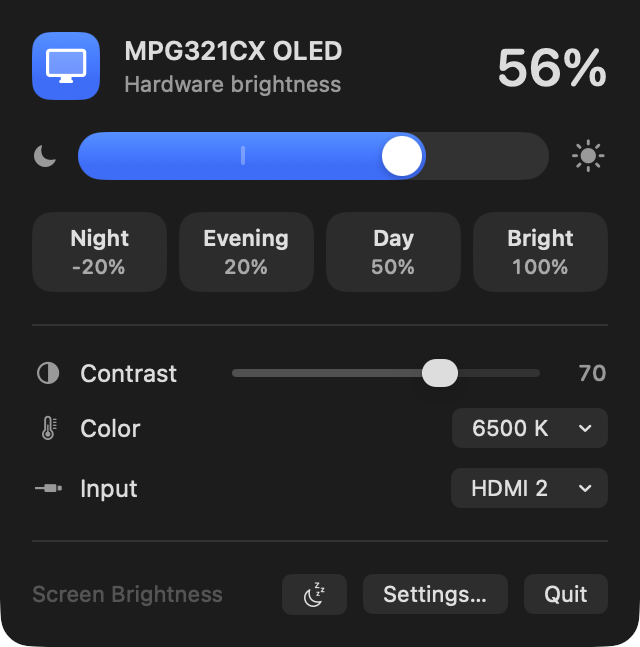

# Screen Brightness

A small macOS menu bar app that controls an external monitor's **real hardware brightness** over DDC/CI, the same way the buttons on the monitor do. It isn't a dimming overlay pretending to be brightness.



Built for an Apple Silicon Mac mini driving an MSI MPG321CX QD-OLED over HDMI. It should work with any monitor that supports DDC/CI.

## Features

- **Brightness slider and presets:** you can rename presets, reorder them, set their levels, and save the current level as a new one. A preset can also switch the monitor's color temperature, so "Evening" can be dimmer and warmer at once.
- **Color temperature:** pick one of the monitor's color presets (such as 5000 K, 6500 K or sRGB) from the menu.
- **Schedule:** presets follow the day, at clock times or at sunrise and sunset, fading over up to an hour. Changing brightness yourself pauses the schedule until its next change; the menu shows what's coming and lets you resume.
- **Keyboard control:**
  - The F1/F2 brightness keys work.
  - Custom global shortcuts work too; the defaults are ⌃⌥⌘↑ and ⌃⌥⌘↓.
  - Hold a key to keep changing brightness, or add ⌥⇧ for quarter steps.
- **Scroll on the menu bar icon** to change brightness.
- **On-screen indicator** in the corner of the monitor while you change brightness or volume.
- **Extra dimming below 0%:** once the monitor is at its minimum, the picture keeps dimming in software, down to 20% of the minimum. It survives restarts. Two methods are available:
  - **Color tables:** the deepest blacks.
  - **Overlay:** works alongside Night Shift, f.lux and HDR.

  Neither shows up in screenshots.
- **Dim when idle:** fades to 0% after a set time without input and restores as soon as you're back. It's skipped while an app such as a video player keeps the display awake. Easier on an OLED.
- **Turn the monitor off when the screen locks:** the displays go to sleep a few seconds after locking, and again if they wake at the lock screen and are left alone, so an OLED doesn't sit on a static lock screen. The menu also has a button to turn the monitor off now.
- **Control Center and menu bar controls:** Brighter, Dimmer, a preset of your choice and Turn Off Monitor. Add them under Control Center › Edit Controls. They work even when the app isn't running; it starts and carries out the command.
- **Contrast, volume and input switching**, shown when the monitor supports them:
  - Volume and mute keys control the monitor's speakers or headphone jack when sound plays over HDMI or DisplayPort, which macOS can't do on its own.
  - Switching to another input asks you to confirm first, because this Mac's picture goes away.
- **Shortcuts and Siri actions:** set, adjust or read brightness, apply a preset, switch input, or turn the monitor off.
- **Brightness lock warning:** the app reads the brightness back after each change. If the monitor ignored it, as some do in HDR or Eco picture modes, the menu says so.
- **Stays in sync** with the monitor's own buttons, sleep and wake, and display reconnects.

## Requirements

- An Apple Silicon Mac running macOS 26 or later.
- A monitor with DDC/CI turned on in its own settings menu. Most monitors have it on by default.
- To build: Xcode 26 or later (developed with Xcode 27) and [XcodeGen](https://github.com/yonaskolb/XcodeGen) (`brew install xcodegen`).

Some ports don't pass DDC through; the built-in HDMI port on M1 Macs is a known example. If the menu says the monitor isn't responding, try a USB-C or Thunderbolt port. The built-in HDMI port on an M4 Mac mini works.

## Build and install

```sh
./build.sh            # builds build/ScreenBrightness.app
./build.sh install    # builds, copies to /Applications and launches it
./build.sh notarize   # builds and notarizes for other Macs (see build.sh for the one-time setup)
```

The Xcode project is generated from `project.yml`. Run `xcodegen generate` to get a `ScreenBrightness.xcodeproj` you can open in Xcode.

**Signing:** set `SIGNING_IDENTITY` and `DEVELOPMENT_TEAM` to sign with your own Developer ID. macOS ties the Accessibility permission to that signature, so the permission survives rebuilds. Without a matching certificate the build is signed ad hoc. That works, but you'll need to grant Accessibility again after each rebuild, and the Control Center controls can't share presets with the app, since that needs an app group tied to a team.

## Permissions

The app asks for **Accessibility** access, which you grant in Privacy & Security › Accessibility. It's needed for three things macOS won't hand to the app otherwise:

- the F1/F2 brightness keys
- the volume keys
- scrolling on the menu bar icon (macOS 26 no longer passes scroll events to status items)

Custom shortcuts, the menu, presets and Shortcuts actions all work without it.

If the schedule uses sunrise or sunset, the app also asks for **Location** once, to work out the times. It keeps only a rounded position (about a kilometer) and refreshes it every few days. Clock times work without it.

## How it works

- **DDC/CI:** the app talks to the monitor over the display cable's I²C channel through `IOAVService`, a private API. It's the same approach used by MonitorControl, Lunar and m1ddc. All traffic runs on one serial queue, and bursts of writes such as a dragged slider are merged so the monitor only receives the latest value.
- **Capabilities:** the monitor's capabilities string is read once per model and cached. It tells the app which controls exist (contrast, volume, mute), which inputs the monitor has and which color presets it offers. The app only ever writes values the monitor lists: on the MSI MPG321CX, writing an unlisted picture mode value hangs the monitor's DDC controller until it's power-cycled. That monitor also ignores picture mode changes over DDC, which is why there's no picture mode control, and it reports color presets under different numbers than the ones that select them, which the app translates.
- **Extra dimming:** this scales the display's gamma tables or uses a black overlay window. Both are removed when the app quits.
- **Schedule:** sunrise and sunset come from NOAA's solar equations, computed locally. The schedule checks every 30 seconds, so long transitions move a step at a time.
- **Turning the monitor off:** the app puts the displays to sleep (`pmset displaysleepnow`) rather than using the monitor's DDC power-off, which some monitors can't be woken from over DDC.
- **Controls:** a small WidgetKit extension. Its buttons send a command to the running app, or launch the app with the command. Presets are shared through an app group.
- **Code layout:** the protocol encoding and decoding, capabilities parsing and brightness math are plain Swift with no system calls, and they're covered by unit tests.

## Tests

```sh
xcodegen generate
xcodebuild test -scheme ScreenBrightness -destination 'platform=macOS'
```

The tests compile the logic files directly rather than launching the app, so they never touch the monitor.

## Project layout

| Path | What's there |
| --- | --- |
| `ScreenBrightness/BrightnessController.swift` | App state: brightness, fades, idle dimming, volume, settings |
| `ScreenBrightness/DDC.swift`, `DDCProtocol.swift` | Monitor I/O and the DDC/CI packet format |
| `ScreenBrightness/MonitorCapabilities.swift` | Capabilities string parsing and input names |
| `ScreenBrightness/SystemInputTap.swift`, `Hotkeys.swift` | Brightness/volume keys, icon scrolling, global shortcuts |
| `ScreenBrightness/SoftwareDimmer.swift` | Extra dimming (gamma tables or overlay) |
| `ScreenBrightness/Schedule.swift`, `SunLocation.swift` | Schedule model, sunrise and sunset, location |
| `ScreenBrightness/DisplaySleep.swift` | Turning the monitor off, screen lock state |
| `ScreenBrightness/BrightnessMenu.swift`, `SettingsView.swift`, `LevelHUD.swift` | UI |
| `ScreenBrightness/Intents.swift`, `SharedIntents.swift` | Shortcuts and Siri actions; the ones the controls share |
| `Controls/` | Control Center and menu bar controls |
| `Tests/` | Unit tests |

## License

MIT. See [LICENSE](LICENSE).
